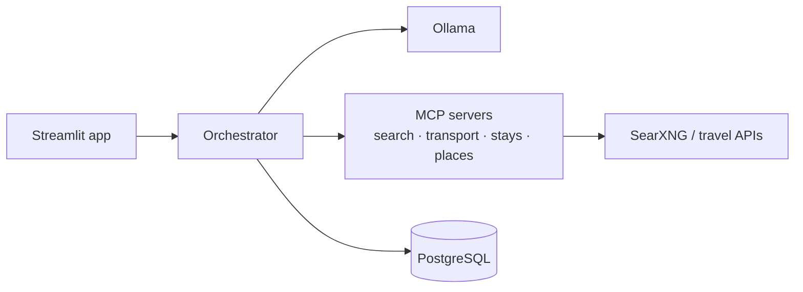

# Architecture

_Filled in during Phases 2, 6 and 10._

## Components

The orchestrator is the only component that talks to the LLM and the MCP servers; profiles stay
in Postgres on your machine.

## Pipeline

_Phase 6: parse → gather → filter → score → write, as a sequence diagram._
